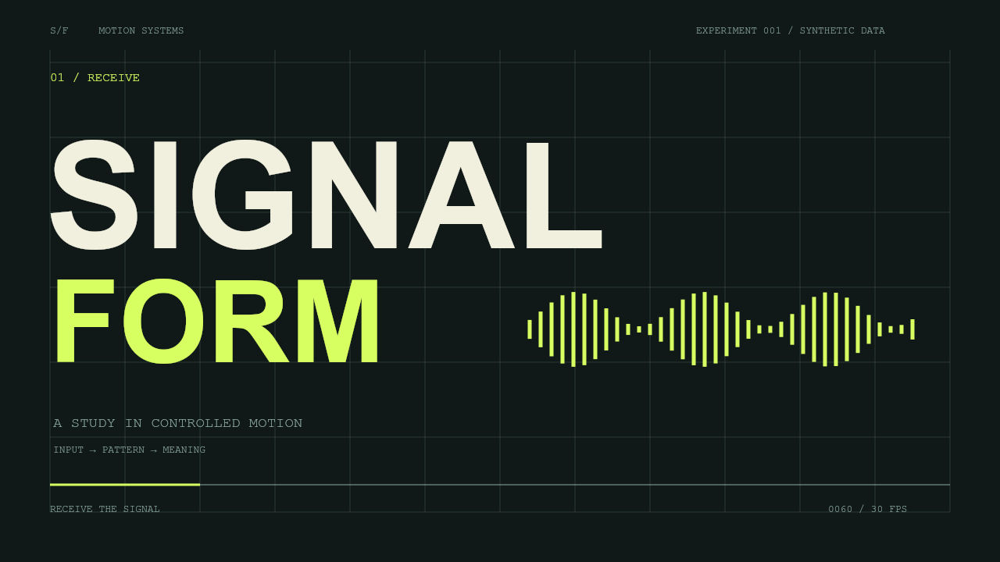

# SIGNAL / FORM

An original, **AI-assisted** code-driven motion design study: kinetic type → an oscillating orbital field → a data-led resolution. Designed as a transparent learning and portfolio starting point, not evidence of unaided authorship or prior client work.



**[Watch the sample MP4](renders/sample.mp4)** · 12 seconds · 1280 × 720 · 30 fps · H.264 · silent

## Run the interactive preview

Requirements: Node.js 20+, npm, Python 3 for the simple preview server, and FFmpeg/ffprobe on PATH for export/inspection. Install FFmpeg from its official distribution or your OS package manager.

```sh
npm install
npm run preview
```

Open http://localhost:8080. Preview uses native HTML5 Canvas with no browser dependencies. Pause/play and the frame slider support inspection; reduced-motion preferences start the preview paused. Serve over HTTP rather than opening index.html as a file (ES modules).

## Export a video

```sh
npm test
npm run render
ffprobe -v error -select_streams v:0 -count_frames -show_entries stream=codec_name,width,height,pix_fmt,r_frame_rate,nb_read_frames,duration -of json renders/sample.mp4
```

Export samples `draw(context, frame, config)` at exact integer frames using @napi-rs/canvas, pipes lossless PNG frames to FFmpeg, and encodes H.264 with CRF 18, yuv420p and fast-start metadata. The 12-second default produces exactly 360 frames. No screen capture, real-time recording or external media is involved. Output overwrites `renders/sample.mp4`, `poster.png` and `render-config.json`.

Equivalent encoding stage:

```sh
ffmpeg -f image2pipe -framerate 30 -vcodec png -i pipe:0 -an -c:v libx264 -preset medium -crf 18 -pix_fmt yuv420p -movflags +faststart renders/sample.mp4
```

The renderer streams frames with backpressure instead of saving a full image sequence. A custom full JSON configuration may be passed with `node scripts/render.mjs path/to/config.json`.

## Art direction and control

| Time | Scene | Motion decision |
| --- | --- | --- |
| 0–4s | Receive | Masked, staggered type reveal with cubic ease-out; phase-driven signal bars |
| 4–8s | Transform | Fifteen orbital contours driven by phase, frequency and amplitude; restrained rotation |
| 8–12s | Resolve | Staggered bar growth and synchronized numeric counters from seven synthetic values |

The dark evergreen field, warm off-white typography and acid-lime accents create a restrained editorial system. A persistent grid, scene labels, progress line and frame counter connect the sequence. Short fades isolate the three visual statements. The fixed design space uses 64-unit side margins; export resolution scales this space proportionally.

Edit `src/config.js`:

- `title`, `subtitle`: opening copy. Title scales horizontally to its allocated width; keep copy short to preserve typography.
- `font`, `mono`: local system font families. Install the same fonts on each machine for consistent metrics.
- `colors`: background, ink, muted, accent and grid colors.
- `data`: finite values from 0 to 100; drives final bar heights and number counters. Seven values are the designed layout; more values can crowd labels.
- `fps`, `duration`, `timings`: scene boundaries and frame sampling. Boundaries must ascend, leave more than one second per scene and end at duration. Copy edits may need layout adjustments.
- `width`, `height`: even export dimensions. Use a 16:9 ratio to preserve proportions; 1920 × 1080 works without layout changes.

## Files

`src/motion.js` is the shared, DOM-independent renderer. `src/config.js` is the editable creative configuration. `index.html` provides browser playback. `scripts/render.mjs` produces the MP4. `scripts/check.mjs` checks deterministic seeking, distinct scenes, data response, boundary rendering and configuration errors. `renders/render-config.json` records the sample's settings.

## Verified sample and limits

The included sample was rendered locally using Node, @napi-rs/canvas 0.1.100 and FFmpeg. ffprobe reported H.264, 1280 × 720, yuv420p, 30/1 fps, 12.000 seconds and 360 decoded frames. Three representative rendered frames were visually inspected. The automated checks passed.

Repeatable **motion state** means the same frame has the same geometry and data state regardless of seek order. Binary-identical output across operating systems, font versions, Canvas implementations or FFmpeg builds is not promised. Browser text antialiasing may differ from the Skia-based video renderer. This is a silent study with no audio-reactive claims, tracking, 3D engine, After Effects project or client-work claims.

## Authorship and application use

This is an AI-assisted project (Codex). Automated checks and the included render were run during preparation. The user has **not** thereby reviewed, modified or independently authored the code.

Before presenting it as personal work, read the source, make meaningful creative/code changes, run the preview and export yourself, and be ready to explain frame sampling, easing, the orbital equations, data normalization and the FFmpeg pipeline. Describe your actual contribution accurately; do not call this unaided “code I wrote.” See `APPLICATION-ANSWER.md` for wording that reflects its current status.

## Publish your reviewed version

Create a public GitHub repository, then from this project folder:

```sh
git init -b main
git add .
git commit -m "Add AI-assisted Signal / Form motion study"
git remote add origin YOUR_REPOSITORY_CLONE_URL
git push -u origin main
```

The clone URL above is a placeholder, not a published link. Keep the AI-assistance disclosure when sharing. No third-party footage, images, audio or bundled fonts are included. Font availability and package licenses remain those of their respective providers.
